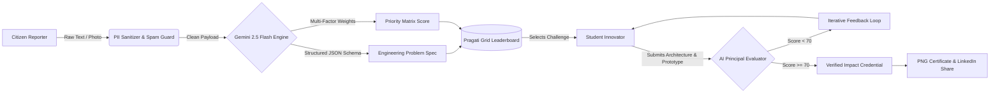

<div align="center">

# 🌐 Pragati Grid
### **AI-Powered Civic Issue Triage & Student Innovation Marketplace**

*Mapping Issues. Ranking Impact. Building Pragati.*

[](https://reactjs.org/)
[](https://www.typescriptlang.org/)
[](https://tailwindcss.com/)
[](https://ai.google.dev/)
[](https://opensource.org/licenses/MIT)

</div>

---

## 📖 Overview

Local communities face daily infrastructure, sanitation, water management, healthcare, and agricultural bottlenecks. When citizens report these issues on traditional portals, complaints are often unstructured, informal, or vague—leading to bureaucratic gridlock and zero prioritization. Simultaneously, millions of university engineering and problem-solving students build generic capstone projects because they lack access to structured, real-world problem statements with measurable community impact.

**Pragati Grid** bridges this gap. It is a two-sided civic innovation engine powered by the **Google Gemini API** that transforms raw, grassroots citizen complaints into structured, priority-ranked engineering challenges, evaluates student-built solutions against rigorous technical rubrics, and issues verifiable **Certificates of Civic Innovation** ready for LinkedIn.

---

## ✨ Key Features

### 1. 🗣️ Multimodal Citizen Triage Engine
* **Raw-to-Spec Transformation:** Citizens can report local problems in plain language, regional dialects/Hinglish, or by uploading field photos across categories like *Drainage, Water Management, Agriculture, Healthcare, Education, Sanitation,* and *Pollution*.
* **Automated PII Guardrails & Spam Filtering:** Automatically redacts sensitive personal data (phone numbers, government IDs, exact house numbers) and filters out gibberish or abusive submissions before publishing.
* **Structured Engineering Output:** Converts raw complaints into formal problem statements featuring Root Cause Hypotheses, Expected Measurable Outcomes, Required Engineering Skills, and UN Sustainable Development Goal (SDG) tags.

### 2. 📊 Dynamic Civic Priority Matrix
* **Multi-Factor AI Scoring:** Every valid issue is evaluated across four weighted dimensions:
  * **Urgency** $(1\text{–}100)$
  * **Population Impact** $(1\text{–}100)$
  * **Severity** $(1\text{–}100)$
  * **Environmental Risk** $(1\text{–}100)$
* **Live Priority Leaderboard:** The main feed dynamically orders problems by their composite **Civic Priority Score**, combined with community upvotes, ensuring the most critical issues rise to the top immediately.

### 3. 🛠️ Student Solution Sandbox & AI Scaffolder
* **1-Click Technical Starter Blueprint:** Students who want to tackle a problem but need architectural direction can generate an AI-assisted 3-step implementation roadmap, suggested low-cost hardware/software stack, and estimated budget tier.
* **Comprehensive Proposal Submission:** University students and teams can submit their technical architectures, bill of materials, deployment budgets, scalability plans, and prototype/repository links.

### 4. ⚖️ Automated Principal Evaluator
* **Objective 5-Pillar Grading:** Submitted solutions are audited directly against the original problem's root causes and expected outcomes across five criteria:
  1. *Problem Fit*
  2. *Technical Feasibility*
  3. *Cost-Effectiveness*
  4. *Innovation*
  5. *Real-World Impact*
* **Actionable Engineering Feedback:** Students receive a detailed scorecard highlighting core strengths, critical field-deployment improvements, and an executive verdict.

### 5. 🎓 Verified Impact Credentials & LinkedIn Integration
* **Tamper-Evident Certificates:** Solutions scoring $\ge 70/100$ automatically unlock an official **Pragati Grid Certificate of Civic Innovation** with a unique verification hash (`PG-2026-XXXX`).
* **Client-Side High-Res Export:** Instant PNG certificate rendering using native HTML5 Canvas.
* **1-Click LinkedIn Profile Deep-Link:** Pre-populates certification details directly into LinkedIn's "Licenses & Certifications" workflow.
* **Public Credential Verifier:** Built-in lookup portal allowing recruiters, faculty, and civic bodies to verify any certificate ID and inspect the underlying AI evaluation scorecard.

---

## 🏗️ System Architecture



---

## 💻 Tech Stack

* **Frontend Framework:** React 18, TypeScript, Vite
* **Styling & UI:** Tailwind CSS, Lucide React Icons
* **AI & LLM Orchestration:** `@google/genai` SDK (`gemini-2.5-flash` with strict `responseSchema` enforcement)
* **Certificate Rendering:** Native HTML5 `<canvas>` & SVG serialization
* **State & Persistence:** React Context / LocalStorage persistence with pre-seeded civic dataset

---

## 🚀 Getting Started

### Prerequisites
* **Node.js** (v18.0.0 or higher)
* **npm** or **yarn**
* A valid **Google Gemini API Key**

### Installation

1. **Clone the repository:**
   ```bash
   git clone https://github.com/your-username/pragati-grid.git
   cd pragati-grid
   ```

2. **Install dependencies:**
   ```bash
   npm install
   ```

3. **Configure environment variables:**
   Create a `.env` file in the root directory and add your Gemini API key:
   ```env
   GEMINI_API_KEY=your_actual_api_key_here
   ```

4. **Start the development server:**
   ```bash
   npm run dev
   ```

5. **Open in browser:**
   Navigate to `http://localhost:5173` (or the port shown in your terminal).

---

## 🔒 Security & Reliability Practices

* **Strict Schema Validation:** All LLM responses enforce `application/json` MIME types paired with strict JSON schemas to prevent UI crashes or hallucinated fields.
* **PII Redaction Pipeline:** System instructions explicitly strip phone numbers, personal identifiers, and exact residential addresses from raw citizen uploads prior to public rendering.
* **Input Sanitization:** Client-side validation restricts payload lengths, strips malicious script tags, and enforces file type and size limits ($\le 4\text{ MB}$) on multimodal image uploads.

---

## 🗺️ Roadmap

- [ ] **Municipal & NGO Bounty Sponsorships:** Allow CSR funds and local Panchayats/Wards to attach micro-grants to top-ranked student solutions.
- [ ] **Geospatial Heatmaps:** Interactive ward-level clustering of drainage, water, and sanitation issues.
- [ ] **Multilingual Voice Reporting:** Direct speech-to-problem-statement pipelines for rural citizens in 10+ regional Indian languages.
- [ ] **GitHub Repository Auditing:** Automated code inspection of student prototype repositories alongside architectural text reviews.

---

## 🤝 Contributing

Contributions are welcome! To contribute:
1. Fork the repository.
2. Create a feature branch (`git checkout -b feature/amazing-feature`).
3. Commit your changes (`git commit -m 'Add amazing feature'`).
4. Push to the branch (`git push origin feature/amazing-feature`).
5. Open a Pull Request.

---

## 📄 License

Distributed under the MIT License. See `LICENSE` for more information.